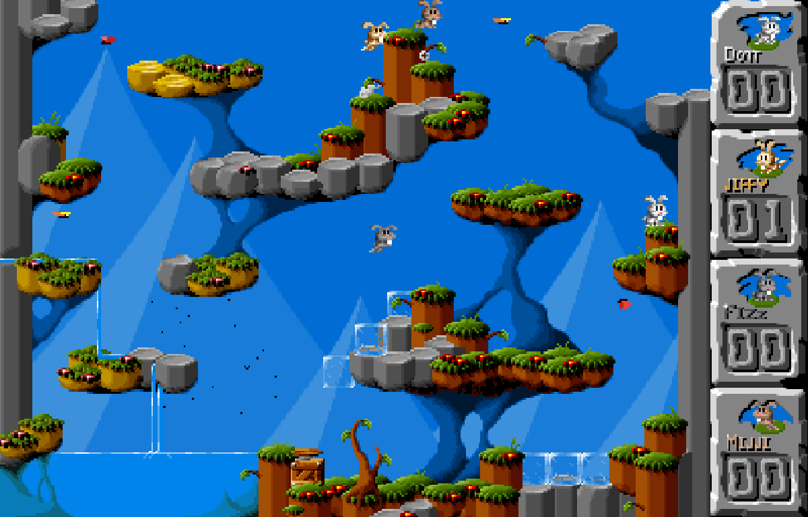

# Jump 'n Bump — browser integration

[Play in your browser](https://oldgamesarchive.org/games/jump-n-bump) ·
[中文试玩](https://oldgamesarchive.org/zh-cn/games/jump-n-bump) ·
[Build instructions](BUILD.md) · [Original README](README.upstream.md)

An unofficial integration of Brainchild Design's **1998 Jump 'n Bump**, the
community SDL2 engine and [midzer's existing Emscripten port](https://github.com/midzer/jumpnbump/tree/emscripten).
This is the original engine and artwork, not a new game or the first web port.

## What's changed

- Clear solo/local multiplayer choices. Solo uses the existing three AI players;
  original menu, arena, physics, scoring and AI are preserved.
- Simultaneous touch move/jump, cancellation and input release on blur; optional
  bridge to the website's shared player and configurable keys.
- Browser canvas clicks focus instead of triggering the legacy grey-rabbit mouse
  controls. Native mouse bindings are retained.
- Full SDL scancode storage and bounds checks, without the 8-bit read alias.
- One Asyncify game loop, software presentation, limited background catch-up,
  default-muted audio, pause/resume and runtime disposal.
- English/Chinese wrapper and help. Original in-game graphics/credits unchanged.

## Playing

Solo uses Left/Right and Up. For local play, up to four people share one computer
and keyboard. Each rabbit jumps over the log in the menu; one participant then
leaves the right edge to start with the rabbits that joined.

| Rabbit | Left | Right | Jump |
| --- | --- | --- | --- |
| White Dott | Left arrow | Right arrow | Up arrow |
| Gold Jiffy | A | D | W |
| Grey Fizz | J | L | I |
| Brown Mijji | Numpad 4 | Numpad 6 | Numpad 8 |

Keys refer to physical QWERTY positions. Esc ends the round and shows scores;
press it again for the menu. Clicking a rabbit does not select it. Upstream
README swaps Dott/Jiffy relative to its HTML manual and game score table; this
table follows the actual engine and sprite colours.

This browser build has no online multiplayer, persistent saves or gamepad
support. Contains cartoon blood. Desktop touch emulation passed; physical
Android/iOS verification remains outstanding for this edition.

## Authors and source

- **Brainchild Design:** Mattias Brynervall (programming), Martin Magnusson and
  Andreas Brynervall (graphics), Anders Nilsson (music).
- **Community:** Chuck Mason (Linux), Florian Schulze (SDL), Ricardo Cruz (AI),
  Côme Chilliet (SDL2), Libre Games and all contributors in [AUTHORS](AUTHORS).
- **Existing browser port:** midzer; base `emscripten` commit
  `47716ab7792f89f0f2ab7d0d7952a9ab21af4d6b`.
- **Website integration and fixes:** Old Games Archive, October 2026.

Code/data remain **GPL-2.0-or-later**; see [COPYING](COPYING). Original copyright
headers, AUTHORS and history remain. No authorship of the original game, AI or
first web port is claimed.

[Exact deployed corresponding source](https://assets.oldgamesarchive.org/games/native/jump-n-bump/84297d297886fbd5a0478a48ead28c64d5278a94563ffadd3bc7df3c80c46297/source.zip)
SHA-256: `b7df85dbffcd0152e884f19b2d7bed77f016331e94f5d2e1ca3225c8619dadc9`.
This branch exposes the fixes as reviewable source files. See [BUILD.md](BUILD.md).

The focused scancode fix and regression test were submitted upstream as
[midzer/jumpnbump#1](https://github.com/midzer/jumpnbump/pull/1).
The full browser integration stays on this branch for separate review.
